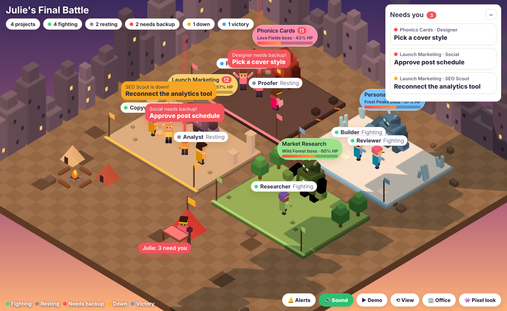

# Final Battle (Agent Office)

A 3D world that shows every project you're running and the agents working on them. There are two worlds; switch with the ⚔️ / 🏢 button or `?theme=battle` / `?theme=office`.

## ⚔️ Battle world (default)

- **Each project is a battle zone** with its own terrain (Lava Fields, Frost Peaks, Ancient Ruins, Wild Forest, Dune Sea) and a **giant boss**. The boss's health bar is the project's remaining work: it drops as your agents' `progress` goes up, and the boss falls over when every agent in the zone is `done`.
- **Agents are heroes** with capes and swords, hammers or magic staffs:
  - **Fighting** (`working`): attacking the boss, firing magic bolts
  - **Resting** (`idle`): heads to the campfire now and then
  - **Needs backup** (`needs_you`): fires a red signal beam into the sky and shows a speech bubble with what they need
  - **Down** (`error`): knocked flat with dizzy stars
  - **Victory** (`done`): arms up, celebrating
- **You're the commander** at the command tent at the front. Its beacon flashes red while anyone needs you.

## 🏢 Office world




- **Each project is a pod**: a colored rug with a desk. Each agent sits at a seat in that pod.
- **The monitor and the light on top of it show the agent's status**:
  - 🟩 **working**: typing, screen flickers
  - ⬜ **idle**: wanders to the coffee bar now and then
  - 🟥 **needs_you**: stands up, jumps, waves, and has a red **!** over its head
  - 🟧 **error**: stands up, scratching its head, with an orange **!**
  - 🟦 **done**: leans back with a spinning blue gem
- **Your desk** sits at the front. Its lamp blinks red while anything needs you.
- **The "Needs you" inbox** (top right) lists every `needs_you` and `error` agent. Click an item to fly to that agent and read what it's asking for. **Mark handled** clears the alert in this browser until the agent posts a new update.
- **Alerts**: a chime plays when something new needs you (after you've clicked the page once). Click 🔔 to also get desktop notifications while the tab is in the background. The tab title shows the count, e.g. `(3) Pixel Office`.
- **Name tags** float over every agent. Anyone who needs you gets a **speech bubble** saying what they need.
- **Two looks**: the default cozy cartoon style, or a chunky retro pixel style (the 👾 / 🧸 button, or `?style=pixel`).
- Drag to rotate, right-drag or two-finger drag to pan, scroll to zoom. **▶ Demo** shuffles statuses so you can see it move.

## Feeding it your real projects

The page reads `data.json` and checks it again every 30 seconds. Each agent looks like this:

```jsonc
{
  "id": "mkt-social",              // unique and stable
  "name": "Social",
  "role": "Social posts",
  "status": "needs_you",           // working | idle | needs_you | error | done
  "task": "10 posts drafted",
  "progress": 0.9,                  // 0..1
  "updated": "2026-11-20T19:30:00Z",// change this whenever the status changes
  "action": {                       // shown when status is needs_you or error
    "title": "Approve post schedule",
    "detail": "Posts are queued for Mon/Wed/Fri at 9am.",
    "link": "https://…"              // optional, http(s) only
  }
}
```

Projects have `id`, `name`, `color` (hex), `description` and `agents`. The top-level `owner.name` labels your desk.

There are two ways to keep it current:

1. **Edit `office/data.json`** in this repo, either by hand or by having your agents commit to it. GitHub Pages redeploys the site and the open page picks up the change on its next check.
2. **Point it at any JSON URL**: `…/office/?data=https://example.com/agents.json`. This can be a raw gist, a small API, or a file your agents write to. The server must allow cross-origin requests.

Add `?demo` to the URL to start in demo mode.

## Running locally

Browsers block `fetch` from `file://`, so serve the folder:

```sh
cd office && python3 -m http.server 8000
# open http://localhost:8000
```

It uses Three.js from the jsDelivr CDN and has no build step.
